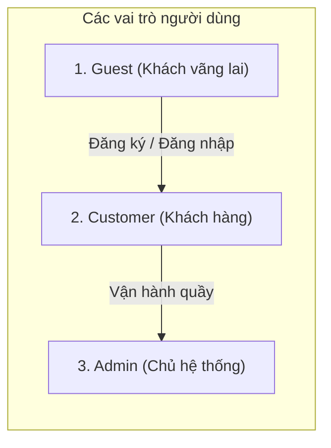
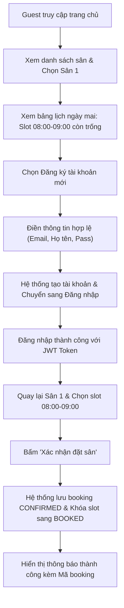
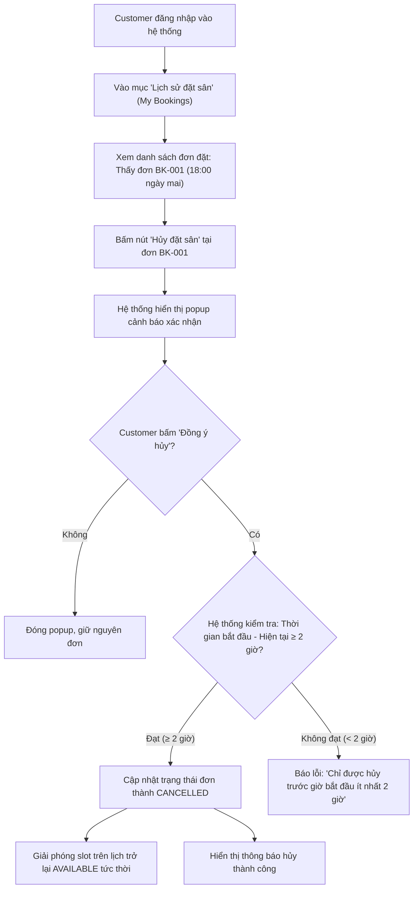
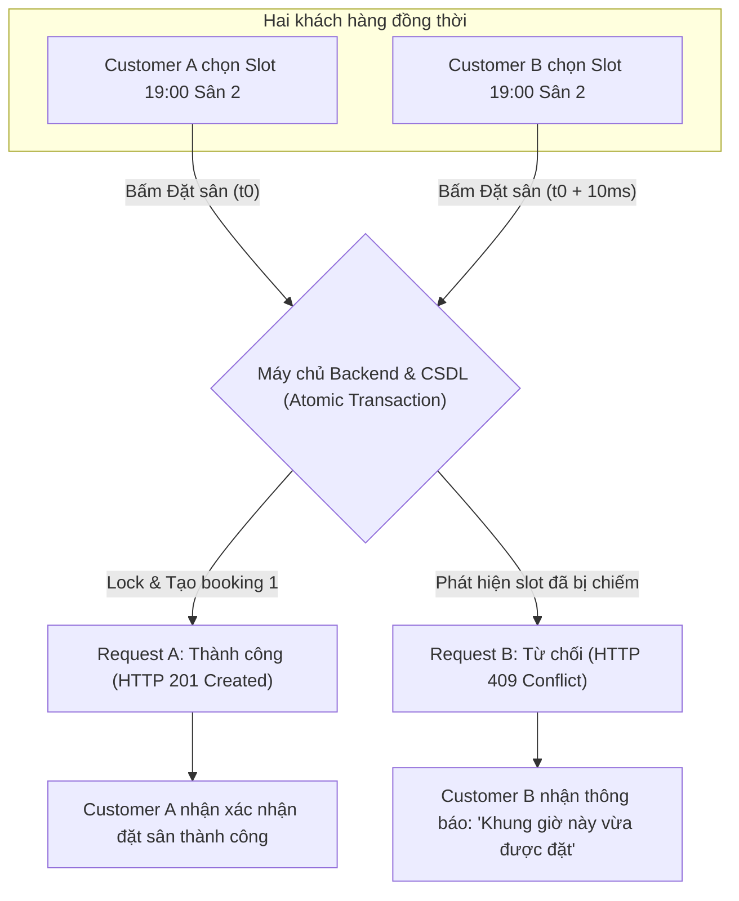

# TÀI LIỆU YÊU CẦU NGƯỜI SỬ DỤNG (URD)
## DỰ ÁN: HỆ THỐNG ĐẶT SÂN CẦU LÔNG (BADMINTON COURT BOOKING SYSTEM)
### Mã tài liệu: `URD-BADMINTON-2026` | Phiên bản: `v3.0`
**Học phần**: Đánh giá hiệu năng / Software Testing – Đồ án cá nhân  
**Người biên soạn**: Chủ hệ thống (System Owner)  

---

## 1. Giới thiệu chung

### 1.1. Mục đích tài liệu
Tài liệu Yêu cầu Người sử dụng (User Requirements Document – URD) này định nghĩa bối cảnh thực tế, mục tiêu của dự án, các vai trò người dùng, danh mục User Stories và các luồng nghiệp vụ cốt lõi của website đặt sân cầu lông. Tài liệu phục vụ làm cơ sở đối chiếu cho tài liệu Đặc tả Yêu cầu Phần mềm (SRS) và hoạt động kiểm thử độc lập.

### 1.2. Phạm vi hệ thống
Hệ thống được giới hạn nghiêm ngặt trong **năm (05) nhóm chức năng cốt lõi**:
1. **Đăng ký tài khoản (Register)**.
2. **Đăng nhập hệ thống (Login)**.
3. **Xem sân và lịch sân (View Court & Availability)**.
4. **Đặt sân (Booking)**.
5. **Hủy đặt sân (Cancel Booking)**.

> [!IMPORTANT]
> **Giới hạn phạm vi (Out of Scope)**:  
> Nhằm phục vụ đúng trọng tâm kiểm thử phần mềm và đánh giá hiệu năng, hệ thống **tuyệt đối không** mở rộng sang các phân hệ thương mại phức tạp như: thanh toán trực tuyến qua ngân hàng/cổng ví, mã giảm giá/voucher, tích điểm thành viên, phòng chat, bình luận/đánh giá sân, quản lý giải đấu, cho thuê phụ kiện (vợt, cầu), đặt đồ ăn nước uống, hay báo cáo kế toán tài chính.

---

## 2. Bối cảnh và Mục tiêu

### 2.1. Bối cảnh thực tế
Hiện nay tại nhiều cơ sở thể thao vừa và nhỏ, việc tiếp nhận yêu cầu đặt sân cầu lông chủ yếu được thực hiện thủ công qua điện thoại, tin nhắn Zalo hoặc sổ sách giấy:
- **Tình trạng thiếu minh bạch**: Khách hàng không thể biết trước khung giờ nào còn trống mà phải nhắn tin hỏi chủ sân nhiều lần.
- **Rủi ro trùng lịch (Double Booking)**: Khi nhiều khách cùng nhắn tin hỏi vào một khung giờ cao điểm, người quản lý dễ ghi nhận trùng lặp, gây tranh cãi và mất uy tín.
- **Quản lý hủy lịch khó khăn**: Việc khách hủy sân sát giờ không được cập nhật tức thì khiến sân bị bỏ trống, trong khi khách khác có nhu cầu lại không biết để đặt.
- **Khó truy vết lịch sử**: Không lưu vết được thời điểm đặt, thời điểm hủy và trạng thái chính xác của từng đơn đặt sân.

### 2.2. Mục tiêu của hệ thống
Hệ thống đặt sân cầu lông trực tuyến hướng tới:
1. Cho phép khách hàng xem danh sách sân, chi tiết sân và bảng lịch còn trống theo thời gian thực 24/7.
2. Cung cấp quy trình đăng ký, đăng nhập an toàn, tiện lợi.
3. Hỗ trợ khách hàng đặt giữ chỗ các khung giờ còn trống và nhận mã xác nhận ngay lập tức.
4. **Loại bỏ 100% tình trạng đặt trùng lịch (Zero Double Booking)** thông qua cơ chế khóa dòng và kiểm tra tranh chấp tại máy chủ.
5. Cho phép khách hàng chủ động quản lý và hủy các lượt đặt sân của chính mình theo đúng thời hạn quy định (trước ít nhất 2 giờ).
6. Tự động giải phóng khung giờ vừa hủy về trạng thái "Còn trống" ngay lập tức để khách khác có thể đặt.

---

## 3. Các vai trò người dùng (User Roles)

Hệ thống phân định rõ ràng **ba (03) vai trò người dùng**:

### 3.1. Khách vãng lai (Guest)
- **Định nghĩa**: Người truy cập website nhưng chưa đăng nhập tài khoản.
- **Quyền hạn**:
  - Xem danh sách tất cả các sân trong cơ sở.
  - Xem thông tin chi tiết từng sân (loại thảm, bảng giá, mô tả).
  - Tra cứu bảng lịch và tình trạng slot còn trống/đã đặt theo ngày.
  - Thực hiện Đăng ký tài khoản mới hoặc Đăng nhập.
- **Hạn chế**:
  - Không thể thực hiện đặt sân (hệ thống yêu cầu đăng nhập trước).
  - Không thể hủy sân hoặc xem thông tin đơn đặt riêng tư của người khác.

### 3.2. Khách hàng (Customer)
- **Định nghĩa**: Người chơi thể thao đã tạo tài khoản và đăng nhập thành công vào hệ thống.
- **Quyền hạn**:
  - Toàn bộ quyền của Guest.
  - Chọn các khung giờ còn trống và tạo đơn đặt sân.
  - Xem danh sách lịch sử các đơn đặt sân của chính bản thân (`My Bookings`).
  - Hủy đơn đặt sân của chính mình khi đơn còn cách giờ thi đấu ít nhất 2 giờ.
- **Hạn chế**:
  - Tuyệt đối không được xem hoặc hủy đơn đặt sân của Customer khác.
  - Không thể truy cập các endpoint hoặc quyền hạn của Quản trị viên (Admin).

### 3.3. Chủ hệ thống / Quản trị viên (System Owner / Admin)
- **Định nghĩa**: Người quản lý cơ sở sân cầu lông, chịu trách nhiệm vận hành.
- **Quyền hạn**:
  - Xem danh sách sân, chi tiết sân và tình trạng lịch sân.
  - Xem danh sách toàn bộ các đơn đặt sân của tất cả khách hàng trong hệ thống.
  - Hủy bất kỳ đơn đặt sân nào khi có lý do kỹ thuật hoặc yêu cầu tại quầy.
  - Truy cập các tiện ích bảo trì dữ liệu kiểm thử (Reset/Seed test data) trong môi trường thử nghiệm.
- **Hạn chế**: Phạm vi của Admin chỉ phục vụ vận hành đặt/hủy sân, không mở rộng sang quản lý tài chính, nhân sự phức tạp.

---

## 4. Danh mục User Stories (Nhu cầu người dùng)

| Mã US | Vai trò | Nội dung User Story (Dạng As a / I want / So that) | Mức ưu tiên | Tiêu chí nghiệm thu (Acceptance Criteria) ở mức người dùng |
| :---: | :---: | :--- | :---: | :--- |
| **`US-01`** | Guest | **Là một** khách vãng lai, **Tôi muốn** đăng ký tài khoản bằng Họ tên, Email và Mật khẩu, **Để** tôi trở thành thành viên và có thể đặt sân trực tuyến. | **High** | 1. Đăng ký thành công với thông tin hợp lệ (Họ tên 2-50 ký tự, email đúng format chưa từng tồn tại, mật khẩu 8-20 ký tự có hoa/thường/số, xác nhận mật khẩu khớp). 2. Báo lỗi rõ ràng khi email đã tồn tại hoặc mật khẩu không đúng quy tắc. |
| **`US-02`** | Guest / Customer | **Là một** người dùng đã có tài khoản, **Tôi muốn** đăng nhập vào hệ thống bằng Email và Mật khẩu, **Để** tôi xác thực danh tính và sử dụng các tính năng đặt sân. | **High** | 1. Đăng nhập thành công chuyển hướng vào trang chủ hoặc danh sách sân và hiển thị tên người dùng. 2. Nhập sai mật khẩu báo lỗi an toàn; nhập sai 5 lần liên tiếp tài khoản bị khóa tạm thời 5 phút. |
| **`US-03`** | Guest / Customer | **Là một** người dùng, **Tôi muốn** xem danh sách các sân cầu lông kèm giá tiền và trạng thái, **Để** tôi chọn được sân phù hợp với nhu cầu. | **High** | 1. Hiển thị danh sách đầy đủ tối thiểu 6 sân cầu lông. 2. Mỗi sân thể hiện rõ tên sân, loại thảm, đơn giá/giờ và trạng thái hoạt động (Hoạt động / Tạm ngừng). |
| **`US-04`** | Guest / Customer | **Là một** người dùng, **Tôi muốn** xem bảng lịch theo ngày của từng sân để biết khung giờ nào còn trống, **Để** tôi lựa chọn thời gian thi đấu phù hợp. | **High** | 1. Bảng lịch chia thành các khung giờ 60 phút từ 06:00 đến 22:00. 2. Phân biệt rõ ô Còn trống (Available) và ô Đã được đặt (Booked). 3. Cho phép chuyển đổi ngày xem lịch nhanh chóng. |
| **`US-05`** | Customer | **Là một** khách hàng đã đăng nhập, **Tôi muốn** chọn một slot còn trống và bấm xác nhận đặt sân, **Để** giữ sân chắc chắn cho buổi chơi thể thao của tôi. | **High** | 1. Chỉ cho phép chọn đặt các slot đang trống trong tương lai. 2. Đặt thành công hệ thống cấp mã đơn đặt sân, chuyển slot sang trạng thái Đã đặt. 3. Nếu có 2 người cùng đặt 1 slot, hệ thống ngăn chặn trùng và chỉ cho 1 người thành công. |
| **`US-06`** | Customer | **Là một** khách hàng, **Tôi muốn** xem danh sách các đơn đặt sân của riêng mình, **Để** tôi theo dõi lịch thi đấu đã đặt và quản lý kế hoạch cá nhân. | **Medium** | 1. Hiển thị danh sách các booking của tài khoản đang đăng nhập. 2. Mỗi đơn thể hiện rõ mã booking, tên sân, ngày đặt, khung giờ và trạng thái (CONFIRMED / CANCELLED). 3. Không nhìn thấy đơn đặt của khách hàng khác. |
| **`US-07`** | Customer | **Là một** khách hàng, **Tôi muốn** hủy một lượt đặt sân của mình khi có việc bận đột xuất, **Để** tôi nhường lại sân cho người khác và hệ thống cập nhật lịch. | **High** | 1. Chỉ được hủy đơn đặt trước giờ bắt đầu thi đấu ít nhất 2 giờ. 2. Khi hủy thành công, trạng thái đơn chuyển thành CANCELLED và khung giờ lập tức trở về trạng thái Còn trống. 3. Nếu thời gian đến giờ chơi còn dưới 2 giờ, hệ thống từ chối hủy kèm thông báo lý do. |
| **`US-08`** | Admin | **Là một** người quản lý sân, **Tôi muốn** xem toàn bộ danh sách booking và hủy booking khi cần thiết, **Để** tôi điều phối hoạt động sân bãi và giải quyết các sự cố phát sinh tại sân. | **Medium** | 1. Admin xem được danh sách tất cả booking trong hệ thống kèm thông tin khách. 2. Admin có quyền hủy booking khi có yêu cầu xử lý trực tiếp tại quầy. |

---

## 5. Ba luồng nghiệp vụ E2E cốt lõi (Core Business Flows)

---

### 5.1. FLOW-01: Người dùng mới đăng ký, đăng nhập và đặt sân thành công
* **Mục tiêu**: Người dùng từ trạng thái chưa có tài khoản có thể tìm kiếm sân, đăng ký định danh, đăng nhập và hoàn tất đặt một slot sân trống.
* **Tác nhân chính (Actor)**: Khách vãng lai (Guest) ➔ Khách hàng (Customer).
* **Điều kiện kích hoạt (Trigger)**: Người dùng có nhu cầu tìm sân thi đấu cầu lông.
* **Tiền điều kiện (Preconditions)**: Hệ thống đang vận hành trực tuyến; Sân 1 ngày mai còn slot `08:00-09:00` ở trạng thái Còn trống (`AVAILABLE`).

#### Chi tiết các bước:
1. **Luồng chính (Main Flow)**:
   - Bước 1: Guest mở website, duyệt qua danh sách các sân cầu lông tại màn hình `Court List`.
   - Bước 2: Bấm vào Sân 1 để xem chi tiết và lịch đặt sân tại màn hình `Court Detail & Availability`.
   - Bước 3: Guest chọn ngày thi đấu mong muốn (ngày mai). Hệ thống tải các khung giờ, ô `08:00-09:00` hiển thị màu xanh (Trống).
   - Bước 4: Guest bấm chọn slot, hệ thống nhắc nhở đăng nhập. Guest chọn "Đăng ký tài khoản".
   - Bước 5: Guest điền đầy đủ Họ tên, Email, Mật khẩu (≥ 8 ký tự, có hoa/thường/số) và Nhập lại mật khẩu, bấm "Đăng ký".
   - Bước 6: Hệ thống tạo tài khoản Customer mới, hiển thị thông báo thành công và chuyển sang màn hình Đăng nhập.
   - Bước 7: Customer nhập Email và Mật khẩu vừa đăng ký, bấm "Đăng nhập". Hệ thống cấp Token xác thực.
   - Bước 8: Customer chọn lại slot `08:00-09:00` Sân 1 và bấm "Xác nhận đặt sân".
   - Bước 9: Hệ thống kiểm tra slot vẫn còn trống, tiến hành ghi nhận đơn đặt với trạng thái `CONFIRMED`, cấp mã `BK-...`.
   - Bước 10: Giao diện hiển thị thông báo thành công và cập nhật ô slot trên bảng lịch sang màu đỏ (`BOOKED`).
2. **Luồng thay thế (Alternative Flow - A1)**:
   - Tại Bước 4, nếu người dùng đã có tài khoản từ trước, người dùng chuyển thẳng sang màn hình Đăng nhập mà không qua bước Đăng ký.
3. **Luồng ngoại lệ (Exception Flow - E1, E2)**:
   - *E1 (Email đăng ký đã tồn tại)*: Tại Bước 5, nếu email đã có tài khoản, hệ thống báo lỗi: `"Email này đã được sử dụng"`. Form giữ nguyên thông tin để người dùng sửa.
   - *E2 (Mật khẩu không đạt độ phức tạp)*: Tại Bước 5, nếu mật khẩu thiếu chữ hoa hoặc < 8 ký tự, hệ thống báo lỗi xác thực dữ liệu.
4. **Hậu điều kiện (Postconditions)**:
   - Đơn đặt sân mới tồn tại trong CSDL ở trạng thái `CONFIRMED` gắn với ID của Customer.
   - Slot `08:00-09:00` ngày mai của Sân 1 chuyển sang trạng thái `BOOKED`, không ai có thể đặt lại.

---

### 5.2. FLOW-02: Customer xem lịch sử và hủy lượt đặt sân hợp lệ
* **Mục tiêu**: Khách hàng đã đặt sân có thể xem lại danh sách các booking của mình và hủy một lượt đặt khi còn đủ thời gian quy định (trước ≥ 2 giờ).
* **Tác nhân chính (Actor)**: Khách hàng (Customer).
* **Điều kiện kích hoạt (Trigger)**: Khách hàng có việc bận không thể đến sân đúng giờ đã hẹn.
* **Tiền điều kiện (Preconditions)**: Customer đã đăng nhập; có 1 booking `CONFIRMED` cho slot lúc `18:00-19:00` ngày mai (cách thời điểm hiện tại > 24 giờ).

#### Chi tiết các bước:
1. **Luồng chính (Main Flow)**:
   - Bước 1: Customer đăng nhập và chọn mục "Lịch sử đặt sân" (`My Bookings`) trên menu.
   - Bước 2: Hệ thống hiển thị các đơn đặt sân của riêng Customer này.
   - Bước 3: Customer chọn đơn đặt slot `18:00-19:00` ngày mai và bấm nút "Hủy đặt sân".
   - Bước 4: Hệ thống hiển thị hộp thoại cảnh báo: *"Bạn có chắc chắn muốn hủy lượt đặt sân này không? Hành động này sẽ mở lại khung giờ cho khách khác."*.
   - Bước 5: Customer bấm nút "Đồng ý hủy".
   - Bước 6: Hệ thống kiểm tra thời gian bắt đầu của slot cách thời điểm hiện tại > 2 giờ, cập nhật trạng thái đơn đặt thành `CANCELLED`.
   - Bước 7: Hệ thống ngay lập tức giải phóng slot `18:00-19:00` ngày mai trên bảng lịch trở về trạng thái Còn trống (`AVAILABLE`).
   - Bước 8: Giao diện hiển thị thông báo thành công: *"Đã hủy lượt đặt sân thành công!"*. Đơn đặt trong danh sách cập nhật nhãn `ĐÃ HỦY`.
2. **Luồng thay thế (Alternative Flow - A1)**:
   - Tại Bước 5, Customer đổi ý bấm nút "Đóng", hệ thống giữ nguyên vẹn đơn đặt sân ở trạng thái `CONFIRMED`.
3. **Luồng ngoại lệ (Exception Flow - E1, E2)**:
   - *E1 (Hủy sát giờ < 2 giờ)*: Nếu Customer cố gắng hủy đơn đặt mà thời gian thi đấu chỉ còn 1 giờ 30 phút nữa, hệ thống chặn lại và báo lỗi: `"Không thể hủy sân. Chỉ được hủy trước thời gian bắt đầu ít nhất 2 giờ!"`.
   - *E2 (Đơn đã bị hủy trước đó)*: Nếu đơn đã ở trạng thái `CANCELLED`, hệ thống từ chối yêu cầu và báo lỗi: `"Đơn đặt sân này đã được hủy trước đó"`.
4. **Hậu điều kiện (Postconditions)**:
   - Bản ghi đơn đặt chuyển thành `CANCELLED`.
   - Khung giờ tương ứng trên bảng lịch chuyển từ màu đỏ sang màu xanh (`AVAILABLE`) để khách hàng khác có thể đặt ngay lập tức.

---

### 5.3. FLOW-03: Hai Customer tranh chấp cùng một slot (Concurrency & Double Booking Prevention)
* **Mục tiêu**: Kiểm tra tính toàn vẹn dữ liệu khi có 2 khách hàng gửi yêu cầu đặt cùng một sân, cùng một ngày và cùng một khung giờ gần như đồng thời.
* **Tác nhân chính (Actors)**: Customer A và Customer B (cùng đăng nhập).
* **Điều kiện kích hoạt (Trigger)**: Hai khách hàng cùng mở lịch và cùng chọn khung giờ cao điểm `19:00-20:00` Sân 2.
* **Tiền điều kiện (Preconditions)**: Slot `19:00-20:00` Sân 2 ngày mai đang ở trạng thái Còn trống (`AVAILABLE`).

#### Chi tiết các bước:
1. **Luồng chính (Main Flow)**:
   - Bước 1: Customer A và Customer B cùng truy cập xem lịch ngày mai của Sân 2.
   - Bước 2: Cả hai người đều nhìn thấy slot `19:00-20:00` đang có màu xanh (Trống).
   - Bước 3: Cả hai cùng bấm vào slot và mở form xác nhận đặt sân.
   - Bước 4: Cả hai bấm nút "Xác nhận đặt sân" gần như cùng một lúc (chênh lệch dưới 50ms).
   - Bước 5: Hai request được gửi đến máy chủ Backend:
     - Request của Customer A được đưa vào Transaction trước: Hệ thống thực hiện kiểm tra và giữ khóa dòng (Locking). Xác nhận slot trống, tạo bản ghi `CONFIRMED` cho Customer A, commit giao dịch.
     - Request của Customer B được xử lý ngay sau đó: Hệ thống phát hiện slot này đã tồn tại một đơn `CONFIRMED` hợp lệ. Transaction của B bị rollback.
   - Bước 6: Backend trả kết quả:
     - Cho Customer A: Mã trạng thái `HTTP 201 Created` kèm thông tin booking.
     - Cho Customer B: Mã lỗi `HTTP 409 Conflict` (hoặc mã lỗi `SLOT_NOT_AVAILABLE`) kèm thông điệp: `"Khung giờ này vừa có người đặt thành công. Vui lòng chọn khung giờ khác!"`.
   - Bước 7: Màn hình của Customer A hiển thị thông báo thành công và chuyển slot sang màu đỏ.
   - Bước 8: Màn hình của Customer B hiển thị cảnh báo tranh chấp nổi bật và tự động làm mới trạng thái ô slot đó thành màu đỏ để B chọn khung giờ khác.
2. **Luồng thay thế (Alternative Flow)**:
   - Không có luồng thay thế. Quy tắc hệ thống chỉ cho phép duy nhất một người đặt thành công.
3. **Luồng ngoại lệ (Exception Flow - E1)**:
   - *E1 (Lỗi kết nối mạng trong lúc xử lý)*: Nếu một trong hai bên gặp gián đoạn kết nối, giao dịch CSDL vẫn đảm bảo tính nguyên tử (Atomicity), không phát sinh bản ghi mồ côi hoặc trạng thái nửa vời.
4. **Hậu điều kiện (Postconditions)**:
   - Trong cơ sở dữ liệu **chỉ tồn tại đúng 01 bản ghi `CONFIRMED`** cho Sân 2 ngày mai lúc `19:00-20:00`.
   - Tuyệt đối không xảy ra hiện tượng Double Booking (đặt trùng lịch).

