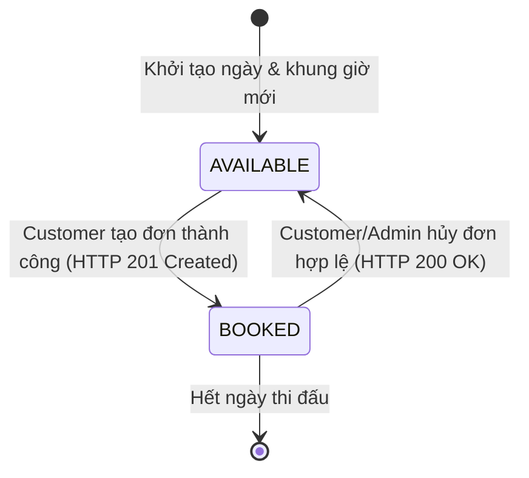
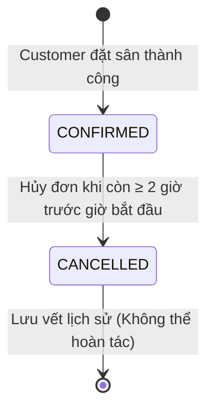

# ĐẶC TẢ YÊU CẦU PHẦN MỀM (SRS)
## DỰ ÁN: HỆ THỐNG ĐẶT SÂN CẦU LÔNG (BADMINTON COURT BOOKING SYSTEM)
### Mã tài liệu: `SRS-BADMINTON-2026` | Phiên bản: `v3.0`
**Học phần**: Đánh giá hiệu năng / Software Testing – Đồ án cá nhân  
**Người biên soạn**: Chủ hệ thống (System Owner)  
**Căn cứ pháp lý**: Chi tiết hóa tài liệu `URD-BADMINTON-2026` v3.0 theo tiêu chuẩn IEEE 830 / ISO 29148  

---

## 1. Giới thiệu chung

### 1.1. Mục đích tài liệu
Tài liệu Đặc tả Yêu cầu Phần mềm (Software Requirements Specification – SRS) này chi tiết hóa đầy đủ các yêu cầu chức năng (Functional Requirements), yêu cầu phi chức năng (Non-Functional Requirements), ràng buộc kiểm tra dữ liệu biên (BVA/EP), bảng quyết định (Decision Table), sơ đồ chuyển trạng thái (State Transition), ma trận phân quyền truy cập (Permission Matrix) và bảng mã lỗi chuẩn toàn hệ thống cho ứng dụng web Đặt sân cầu lông.

### 1.2. Phạm vi sản phẩm
- **Nền tảng Backend**: Node.js + Express RESTful API (Base URL: `/api/v1`), cơ sở dữ liệu hỗ trợ cả MySQL và In-Memory/SQLite Store phục vụ môi trường kiểm thử độc lập.
- **Nền tảng Frontend**: React Single Page Application (SPA), tích hợp bộ chọn ổn định `data-testid` trên toàn bộ các thành phần giao diện phục vụ kiểm thử tự động (E2E Test Automation).
- **Phạm vi nghiệp vụ**: Giới hạn trong 5 nhóm chức năng: Đăng ký, Đăng nhập, Xem sân & Lịch sân, Đặt sân, Hủy đặt sân. Không phát triển các tính năng thanh toán, tích điểm, giải đấu hay thương mại phức tạp.

### 1.3. Hệ thống quy ước mã yêu cầu (Requirement Tagging Scheme)
- **`FR-xxx`**: Yêu cầu chức năng tổng thể (Functional Requirement).
- **`VAL-xxx`**: Ràng buộc kiểm tra dữ liệu đầu vào (Validation Rule).
- **`BUS-xxx`**: Quy tắc xử lý nghiệp vụ (Business Rule).
- **`DIS-xxx`**: Quy tắc hiển thị / Trạng thái giao diện (Display / UI Rule).
- **`ERR-xxx`**: Xử lý lỗi và thông điệp lỗi (Error Handling Rule).
- **`NFR-xxx`**: Yêu cầu phi chức năng (Non-Functional Requirement).

---

## 2. Các tác nhân và Ma trận phân quyền truy cập

### 2.1. Danh sách tác nhân (Actors)
1. **Guest (Khách vãng lai)**: Người dùng chưa đăng nhập.
2. **Customer (Khách hàng)**: Người chơi thể thao đã đăng ký tài khoản và có phiên đăng nhập hợp lệ.
3. **System Owner / Admin (Chủ hệ thống)**: Người vận hành cơ sở sân cầu lông.

### 2.2. Ma trận phân quyền truy cập (Permission Matrix)

| Hành động nghiệp vụ / API Endpoint | Guest (Chưa đăng nhập) | Customer (Khách hàng) | Admin (Chủ hệ thống) | Cơ chế thực thi (Enforcement) |
| :--- | :---: | :---: | :---: | :--- |
| **Xem danh sách sân** (`GET /api/v1/courts`) | Cho phép (Yes) | Cho phép (Yes) | Cho phép (Yes) | Public Endpoint |
| **Xem chi tiết sân** (`GET /api/v1/courts/{id}`) | Cho phép (Yes) | Cho phép (Yes) | Cho phép (Yes) | Public Endpoint |
| **Xem lịch sân trống** (`GET /api/v1/courts/{id}/availability`) | Cho phép (Yes) | Cho phép (Yes) | Cho phép (Yes) | Public Endpoint |
| **Đăng ký tài khoản** (`POST /api/v1/auth/register`) | Cho phép (Yes) | N/A | N/A | Public Endpoint |
| **Đăng nhập hệ thống** (`POST /api/v1/auth/login`) | Cho phép (Yes) | Cho phép (Yes) | Cho phép (Yes) | Public Endpoint |
| **Tạo đơn đặt sân** (`POST /api/v1/bookings`) | ❌ Chặn (401) | Cho phép (Yes) | Cho phép (Yes) | Middleware `authRequired` |
| **Xem booking của chính mình** (`GET /api/v1/bookings/me`) | ❌ Chặn (401) | Cho phép (Yes) | Cho phép (Yes) | Lọc theo `req.user.id` |
| **Xem toàn bộ booking hệ thống** (`GET /api/v1/admin/bookings`) | ❌ Chặn (401) | ❌ Chặn (403) | Cho phép (Yes) | Middleware `adminOnly` |
| **Hủy booking của chính mình** (`PATCH /api/v1/bookings/{id}/cancel`) | ❌ Chặn (401) | Cho phép (nếu ≥ 2h) | Cho phép (Yes) | Kiểm tra quyền sở hữu & mốc 2h |
| **Hủy booking của Customer khác** | ❌ Chặn (401) | ❌ Chặn (403/404) | Cho phép (Yes) | Kiểm tra `user_id == booking.user_id` |

---

## 3. Quy tắc kiểm tra dữ liệu đầu vào (Project-Defined Data Validation)

Tất cả các ràng buộc dưới đây là các yêu cầu được định nghĩa chính thức của dự án (`Project-defined requirements`) để phục vụ kiểm thử phân vùng tương đương (EP) và phân tích giá trị biên (BVA):

### 3.1. Họ và tên (`fullName`)
- **Bắt buộc nhập**: Chuỗi ký tự (String).
- **Độ dài**: Tối thiểu 2 ký tự, tối đa 50 ký tự.
- **Giá trị kiểm thử biên (BVA)**:
  - 1 ký tự: Không hợp lệ (Báo lỗi `VALIDATION_ERROR`).
  - 2 ký tự: Hợp lệ (Biên dưới).
  - 50 ký tự: Hợp lệ (Biên trên).
  - 51 ký tự: Không hợp lệ (Báo lỗi `VALIDATION_ERROR`).

### 3.2. Email (`email`)
- **Bắt buộc nhập**: Chuỗi ký tự format email hợp lệ theo RFC 5322.
- **Độ dài**: Tối đa 100 ký tự.
- **Tính duy nhất (Unique)**: Không được trùng với tài khoản đã tồn tại trong CSDL.
- **Không phân biệt hoa thường (Case-Insensitive)**: `User@Test.com` và `user@test.com` được coi là cùng một địa chỉ email. Hệ thống tự động chuyển email về chữ thường (`toLowerCase()`) trước khi kiểm tra và lưu trữ.

### 3.3. Mật khẩu (`password`)
- **Bắt buộc nhập**: Chuỗi ký tự.
- **Độ dài**: Từ 8 đến 20 ký tự.
- **Độ phức tạp**: Phải chứa ít nhất 1 chữ cái in hoa (`A-Z`), ít nhất 1 chữ cái in thường (`a-z`), và ít nhất 1 chữ số (`0-9`).
- **Giá trị kiểm thử biên (BVA)**:
  - 7 ký tự: Không hợp lệ (Báo lỗi `VALIDATION_ERROR`).
  - 8 ký tự: Hợp lệ (Biên dưới).
  - 20 ký tự: Hợp lệ (Biên trên).
  - 21 ký tự: Không hợp lệ (Báo lỗi `VALIDATION_ERROR`).

### 3.4. Xác nhận mật khẩu (`confirmPassword`)
- **Bắt buộc nhập**: Phải trùng khớp tuyệt đối 100% với giá trị của `password`.

### 3.5. Quy tắc khóa đăng nhập an toàn (Account Lockout)
- Nếu người dùng nhập sai mật khẩu **5 lần liên tiếp**, tài khoản sẽ bị tạm khóa đăng nhập trong vòng **5 phút**.
- Sau thời gian khóa 5 phút, người dùng có thể thử lại bình thường.
- Thông báo lỗi khi đăng nhập sai không được tiết lộ rõ email có tồn tại hay không nhằm phòng chống tấn công dò quét tài khoản (`Enumeration Attack`).
- Thời hạn hiệu lực của JWT Token là 24 giờ.

---

## 4. Danh mục Sân cầu lông và Khung giờ thi đấu

### 4.1. Danh mục Sân (Courts)
Hệ thống khởi tạo tối thiểu 6 sân cầu lông (`Court 1` đến `Court 6`):
- `Court 1`: Sân 1 - Thảm Enlio Tiêu Chuẩn - 120.000 VNĐ/giờ - Trạng thái: `ACTIVE`.
- `Court 2`: Sân 2 - Thảm Enlio Tiêu Chuẩn - 120.000 VNĐ/giờ - Trạng thái: `ACTIVE`.
- `Court 3`: Sân 3 - Thảm Yonex Thi Đấu - 150.000 VNĐ/giờ - Trạng thái: `ACTIVE`.
- `Court 4`: Sân 4 - Thảm Yonex Thi Đấu - 150.000 VNĐ/giờ - Trạng thái: `ACTIVE`.
- `Court 5`: Sân 5 - Thảm Alite Phong Trào - 100.000 VNĐ/giờ - Trạng thái: `ACTIVE`.
- `Court 6`: Sân 6 - Thảm Alite Phong Trào - 100.000 VNĐ/giờ - Trạng thái: **`INACTIVE`** (Sân đang bảo trì hệ thống chiếu sáng, không cho phép đặt).

### 4.2. Khung giờ hoạt động cố định (Operating Slots)
Mỗi ngày thi đấu được chia thành **16 khung giờ cố định tròn 60 phút** từ 06:00 đến 22:00:
`06:00-07:00`, `07:00-08:00`, `08:00-09:00`, `09:00-10:00`, `10:00-11:00`, `11:00-12:00`, `12:00-13:00`, `13:00-14:00`, `14:00-15:00`, `15:00-16:00`, `16:00-17:00`, `17:00-18:00`, `18:00-19:00`, `19:00-20:00`, `20:00-21:00`, `21:00-22:00`.

---

## 5. Đặc tả chi tiết 19 Yêu cầu Chức năng (Functional Requirements)

---

### PHÂN HỆ 1: ĐĂNG KÝ TÀI KHOẢN (REGISTER)
- **`FR-REG-01`**: Hệ thống hiển thị form đăng ký tài khoản thành viên với các trường: Họ và tên, Email, Mật khẩu, Xác nhận mật khẩu (`DIS-REG-01`).
- **`FR-REG-02`**: Hệ thống tiếp nhận thông tin đăng ký hợp lệ, mã hóa mật khẩu bằng Bcrypt (Salt rounds ≥ 10), lưu tài khoản vào CSDL với vai trò `CUSTOMER` và trả về mã thành công `HTTP 201 Created` (`BUS-REG-01`).
- **`FR-REG-03`**: Hệ thống kiểm tra tính duy nhất của email không phân biệt hoa thường (`VAL-REG-03`). Nếu email đã tồn tại, từ chối đăng ký và trả về mã lỗi `HTTP 400 Bad Request` kèm mã lỗi `EMAIL_ALREADY_EXISTS` (`ERR-REG-01`).

### PHÂN HỆ 2: ĐĂNG NHẬP VÀ XÁC THỰC (LOGIN & AUTH)
- **`FR-AUTH-01`**: Cho phép người dùng nhập Email và Mật khẩu để đăng nhập. Nếu thông tin chính xác, hệ thống trả về mã JSON Web Token (JWT) có thời hạn hiệu lực kèm thông tin người dùng (`HTTP 200 OK`) (`BUS-AUTH-01`).
- **`FR-AUTH-02`**: Nếu người dùng nhập sai email hoặc mật khẩu, hệ thống trả về mã lỗi `HTTP 401 Unauthorized` kèm mã lỗi `AUTH_INVALID_CREDENTIALS`. Sau 5 lần nhập sai liên tiếp, hệ thống khóa tài khoản 5 phút và trả về mã lỗi `AUTH_LOCKED` (`ERR-AUTH-01`).
- **`FR-AUTH-03`**: Hệ thống quản lý quyền truy cập các endpoint nghiệp vụ. Nếu request thiếu Token Bearer hoặc Token không hợp lệ, hệ thống trả về `HTTP 401 Unauthorized` (`UNAUTHORIZED`). Nếu người dùng không đủ quyền hạn, trả về `HTTP 403 Forbidden` (`FORBIDDEN`).

### PHÂN HỆ 3: XEM SÂN VÀ LỊCH SÂN (COURT & AVAILABILITY)
- **`FR-COURT-01`**: Hệ thống cung cấp danh sách đầy đủ tất cả các sân trong cụm gồm: mã sân, tên sân, loại thảm, đơn giá theo giờ và trạng thái hoạt động (`GET /api/v1/courts`) (`DIS-COURT-01`).
- **`FR-COURT-02`**: Hệ thống cung cấp thông tin chi tiết của một sân cụ thể theo mã định danh `court_id` (`GET /api/v1/courts/{id}`). Nếu không tìm thấy sân, trả về `HTTP 404 Not Found` kèm mã lỗi `COURT_NOT_FOUND` (`ERR-COURT-01`).
- **`FR-COURT-03`**: Hệ thống hiển thị bảng lịch các khung giờ hoạt động trong ngày của sân theo tham số `date` (`YYYY-MM-DD`). Mặc định khi không truyền ngày là ngày hiện tại (`DIS-COURT-02`).
- **`FR-COURT-04`**: Hệ thống hiển thị rõ ràng trạng thái của từng ô slot trong ngày: Màu xanh (`AVAILABLE`) nếu khung giờ chưa có ai đặt; Màu đỏ (`BOOKED`) nếu khung giờ đã có đơn đặt ở trạng thái `CONFIRMED` (`DIS-COURT-03`).

### PHÂN HỆ 4: ĐẶT SÂN (BOOKING CREATION)
- **`FR-BOOK-01`**: Cho phép Customer tạo đơn đặt sân cho một slot đang ở trạng thái `AVAILABLE`. Đơn đặt thành công được gán trạng thái `CONFIRMED`, cấp mã định danh duy nhất (`booking_code`), lưu vết `user_id`, `court_id`, `booking_date`, `time_slot`, và thời điểm tạo (`BUS-BOOK-01`).
- **`FR-BOOK-02`**: Hệ thống kiểm tra tính hợp lệ trước khi tạo đơn: Sân phải ở trạng thái `ACTIVE` (nếu sân `INACTIVE`, trả về mã lỗi `COURT_INACTIVE`), và ngày/khung giờ đặt phải nằm trong tương lai so với thời điểm hiện tại của máy chủ. Nếu đặt slot trong quá khứ, trả về `HTTP 400 Bad Request` kèm mã lỗi `INVALID_BOOKING_TIME` (`VAL-BOOK-01`).
- **`FR-BOOK-03`**: **Quy tắc chống Double Booking tuyệt đối ở Backend/Database**: Không được tồn tại hai booking `CONFIRMED` cho cùng bộ ba giá trị `[court_id, booking_date, time_slot]`. Hệ thống phải sử dụng Database Transaction kết hợp khóa dòng Pessimistic Locking hoặc Unique Constraint. Nếu phát sinh tranh chấp đồng thời, chỉ 1 request thành công (`HTTP 201`), request còn lại bị từ chối với `HTTP 409 Conflict` kèm mã lỗi `SLOT_NOT_AVAILABLE` (`BUS-BOOK-03` & `NFR-DATA-01`).
- **`FR-BOOK-04`**: Cho phép Customer tra cứu danh sách toàn bộ các đơn đặt sân của chính mình (`GET /api/v1/bookings/me`). Khách hàng không thể xem đơn đặt của Customer khác (`DIS-BOOK-02`).

### PHÂN HỆ 5: HỦY ĐẶT SÂN (CANCEL BOOKING)
- **`FR-CANCEL-01`**: Cho phép Customer hủy đơn đặt sân của chính mình (`PATCH /api/v1/bookings/{id}/cancel`) khi đáp ứng điều kiện: Thời gian bắt đầu thi đấu cách thời điểm hủy **ít nhất 2 giờ** (`BUS-CANCEL-01`). Khi hủy thành công, trạng thái chuyển sang `CANCELLED`, lưu vết `cancelled_at` và trả về `HTTP 200 OK`.
- **`FR-CANCEL-02`**: Hệ thống chặn mọi hành vi hủy đơn không hợp lệ:
  - Nếu Customer cố tình hủy đơn của Customer khác: Trả về `HTTP 403 Forbidden` kèm mã lỗi `FORBIDDEN`.
  - Nếu thời gian thi đấu cách thời điểm hủy **dưới 2 giờ**: Từ chối hủy, trả về `HTTP 400 Bad Request` kèm mã lỗi `CANCEL_NOT_ALLOWED` (`ERR-CANCEL-01`).
  - Nếu đơn đặt đã bị hủy trước đó: Trả về `HTTP 400 Bad Request` kèm mã lỗi `CANCEL_NOT_ALLOWED`.
- **`FR-CANCEL-03`**: Ngay sau khi đơn đặt chuyển sang trạng thái `CANCELLED`, hệ thống tự động giải phóng khung giờ đó, slot trên bảng lịch lập tức trở về trạng thái `AVAILABLE` (Màu xanh) để người khác có thể đặt lại ngay (`BUS-CANCEL-02` & `DIS-CANCEL-01`).

### PHÂN HỆ 6: QUẢN TRỊ VẬN HÀNH (ADMIN OPERATIONS)
- **`FR-ADMIN-01`**: Cho phép Admin xem danh sách tất cả các đơn đặt sân của toàn bộ khách hàng trong hệ thống kèm thông tin liên hệ và trạng thái (`GET /api/v1/admin/bookings`).
- **`FR-ADMIN-02`**: Cho phép Admin thực hiện hủy bất kỳ đơn đặt sân nào khi phát sinh yêu cầu đột xuất tại quầy hoặc sự cố kỹ thuật sân bãi (`PATCH /api/v1/admin/bookings/{id}/cancel`).

---

## 6. Bảng quyết định và Sơ đồ trạng thái

### 6.1. Bảng quyết định Đặt sân (Decision Table for Booking Creation)

| Điều kiện (Conditions) | R1 | R2 | R3 | R4 | R5 |
| :--- | :---: | :---: | :---: | :---: | :---: |
| Đã đăng nhập tài khoản Customer hợp lệ? | **No** | **Yes** | **Yes** | **Yes** | **Yes** |
| Sân thi đấu đang ở trạng thái ACTIVE? | - | **No** | **Yes** | **Yes** | **Yes** |
| Ngày và khung giờ đặt nằm trong tương lai? | - | - | **No** | **Yes** | **Yes** |
| Slot đang ở trạng thái Còn trống (AVAILABLE)? | - | - | - | **No (Trùng)**| **Yes** |
| **Hành động / Kết quả (Actions)** | | | | | |
| Trả về mã lỗi `HTTP 401` (`UNAUTHORIZED`) | **X** | | | | |
| Trả về mã lỗi `HTTP 400` (`COURT_INACTIVE`) | | **X** | | | |
| Trả về mã lỗi `HTTP 400` (`INVALID_BOOKING_TIME`)| | | **X** | | |
| Trả về mã lỗi `HTTP 409` (`SLOT_NOT_AVAILABLE`)| | | | **X** | |
| Tạo booking `CONFIRMED`, `HTTP 201`, khóa slot | | | | | **X** |

---

### 6.2. Sơ đồ trạng thái Vòng đời Booking và Khung giờ (State Transitions)

> [!CAUTION]
> **Quy tắc bất biến về trạng thái**:  
> Tuyệt đối không có hành động nào cho phép chuyển trạng thái ngược từ `CANCELLED` trở lại `CONFIRMED`.

---

## 7. Yêu cầu Phi chức năng (Non-Functional Requirements – 10 NFR)

### 7.1. Hiệu năng (Performance - 4 NFR)
- **`NFR-PERF-01`**: Với tải 100 người dùng ảo đồng thời (100 Virtual Users), thời gian đáp ứng phân vị 90 (P90) của API `GET /api/v1/courts` phải đạt:
  $$\text{P90} \le 1.000\text{ ms}$$
- **`NFR-PERF-02`**: Với tải 100 người dùng ảo đồng thời, thời gian đáp ứng phân vị 90 (P90) của API tra cứu lịch sân trống `GET /api/v1/courts/{id}/availability` phải đạt:
  $$\text{P90} \le 1.000\text{ ms}$$
- **`NFR-PERF-03`**: Với tải 50 người dùng ảo đồng thời, thời gian đáp ứng phân vị 90 (P90) của API tạo đơn đặt sân `POST /api/v1/bookings` phải đạt:
  $$\text{P90} \le 2.000\text{ ms}$$
- **`NFR-PERF-04`**: Dưới kịch bản tải vận hành thông thường (Normal Load Scenario), tỉ lệ lỗi hệ thống (Error Rate) phải đạt:
  $$\text{Error Rate} < 1,0\%$$

### 7.2. An toàn bảo mật (Security - 2 NFR)
- **`NFR-SEC-01`**: Mật khẩu người dùng tuyệt đối không lưu dạng văn bản thô (Plaintext). Mật khẩu bắt buộc mã hóa băm bằng thuật toán Bcrypt với hệ số Salt Rounds:
  $$\text{Cost Factor} \ge 10$$
- **`NFR-SEC-02`**: Các endpoint được bảo vệ (Protected APIs) bắt buộc kiểm tra mã Token JWT. Người dùng chưa đăng nhập phải nhận mã lỗi `HTTP 401 Unauthorized`; người dùng không đủ quyền truy cập phải nhận mã lỗi `HTTP 403 Forbidden`.

### 7.3. Giao diện thích ứng (Responsive UI - 1 NFR)
- **`NFR-UI-01`**: Các màn hình chính (Danh sách sân, Lịch sân, Đặt sân, Lịch sử đặt sân) không được xuất hiện thanh cuộn ngang toàn trang ngoài ý muốn (No Full-Page Horizontal Scroll) tại 3 độ phân giải tiêu chuẩn:
  - Mobile hẹp: **360 px**.
  - Tablet: **768 px**.
  - Desktop: **1440 px**.

### 7.4. Tính tương thích trình duyệt (Browser Compatibility - 1 NFR)
- **`NFR-COMP-01`**: Toàn bộ luồng nghiệp vụ chính phải vận hành đồng nhất, không lỗi giao diện trên hai phiên bản gần nhất của các trình duyệt: Google Chrome, Microsoft Edge, và Mozilla Firefox.

### 7.5. Tính toàn vẹn dữ liệu (Data Integrity - 1 NFR)
- **`NFR-DATA-01`**: Cơ sở dữ liệu và máy chủ đảm bảo 100% không bao giờ tồn tại hai bản ghi đơn đặt sân cùng ở trạng thái `CONFIRMED` cho cùng một sân, cùng một ngày và cùng một khung giờ thi đấu (Zero Double Booking).

### 7.6. Tính sẵn sàng hệ thống (System Availability - 1 NFR)
- **`NFR-AVAIL-01`**: Ứng dụng cung cấp endpoint giám sát `GET /health` phản ánh tình trạng máy chủ và CSDL. Tỉ lệ sẵn sàng (Uptime Availability) mục tiêu đạt:
  $$\text{Availability} \ge 99,5\%$$

---

## 8. Ma trận truy vết yêu cầu (Requirement Traceability Matrix – RTM)

| Yêu cầu Người dùng (URD) | Yêu cầu Chức năng (SRS) | Quy tắc Nghiệp vụ / Ràng buộc | Màn hình / Endpoint API | Điểm kiểm thử đề xuất (Suggested Test Points) |
| :--- | :--- | :--- | :--- | :--- |
| **`US-01`** (Đăng ký) | `FR-REG-01` `FR-REG-02` `FR-REG-03` | `VAL-REG-01..04` `BUS-REG-01` `ERR-REG-01` | Màn hình Đăng ký `POST /api/v1/auth/register` | BVA Full Name (1, 2, 50, 51); BVA Password (7, 8, 20, 21); Trùng email hoa thường; Đăng ký thành công. |
| **`US-02`** (Đăng nhập) | `FR-AUTH-01` `FR-AUTH-02` `FR-AUTH-03` | `BUS-AUTH-01` `ERR-AUTH-01` `NFR-SEC-01..02` | Màn hình Đăng nhập `POST /api/v1/auth/login` | Đăng nhập đúng cấp JWT; Sai mật khẩu; Khóa 5 phút khi sai liên tiếp 5 lần; Chặn API khi thiếu Token. |
| **`US-03`** (Xem sân) | `FR-COURT-01` `FR-COURT-02` | `DIS-COURT-01` `ERR-COURT-01` | Màn hình Court List `GET /api/v1/courts` | Hiển thị đủ 6 sân; Xem sân active và inactive; Tải P90 ≤ 1000ms với 100 virtual users. |
| **`US-04`** (Xem lịch) | `FR-COURT-03` `FR-COURT-04` | `DIS-COURT-02..03` `NFR-PERF-02` | Màn hình Availability `GET /api/v1/courts/{id}/availability` | Đổi ngày xem lịch; Hiển thị đúng ô Xanh (Trống) và Đỏ (Đã đặt); Tải 100 users P90 ≤ 1000ms. |
| **`US-05`** (Đặt sân) | `FR-BOOK-01` `FR-BOOK-02` `FR-BOOK-03` | `VAL-BOOK-01` `BUS-BOOK-01..03` `NFR-DATA-01` | Màn hình Đặt sân `POST /api/v1/bookings` | Đặt slot trống thành công; Chặn đặt sân inactive; Chặn đặt slot quá khứ; Kiểm thử tải tranh chấp concurrency (chống double booking). |
| **`US-06`** (Xem booking) | `FR-BOOK-04` | `DIS-BOOK-02` | Màn hình My Bookings `GET /api/v1/bookings/me` | Customer chỉ xem được đơn của mình; Phân trang/danh sách hiển thị đúng mã và trạng thái. |
| **`US-07`** (Hủy sân) | `FR-CANCEL-01` `FR-CANCEL-02` `FR-CANCEL-03` | `BUS-CANCEL-01..02` `ERR-CANCEL-01` | Màn hình Chi tiết / Hủy `PATCH /api/v1/bookings/{id}/cancel`| Hủy trước > 2h thành công, slot chuyển sang Xanh; Chặn hủy khi còn < 2h; Chặn Customer A hủy booking của Customer B. |
| **`US-08`** (Admin) | `FR-ADMIN-01` `FR-ADMIN-02` | Permission Matrix | Màn hình Quản trị `GET /api/v1/admin/bookings` | Admin xem toàn bộ booking; Admin hủy đơn thành công; Customer bị 403 khi gọi endpoint này. |

---

## 9. Bảng mã lỗi chuẩn toàn hệ thống (System Error Code Table)

| Mã lỗi (Error Code) | Mã HTTP | Mô tả ý nghĩa nghiệp vụ | Thông điệp hiển thị mẫu |
| :--- | :---: | :--- | :--- |
| **`VALIDATION_ERROR`** | `400 Bad Request` | Dữ liệu đầu vào vi phạm định dạng hoặc giá trị biên (BVA/EP) | Dữ liệu cung cấp không hợp lệ. Vui lòng kiểm tra lại |
| **`EMAIL_ALREADY_EXISTS`** | `400 Bad Request` | Email đăng ký đã tồn tại trong hệ thống | Email này đã được đăng ký tài khoản thành viên |
| **`AUTH_INVALID_CREDENTIALS`** | `401 Unauthorized` | Email hoặc mật khẩu đăng nhập không chính xác | Email hoặc mật khẩu không chính xác |
| **`AUTH_LOCKED`** | `401 Unauthorized` | Tài khoản bị tạm khóa 5 phút do nhập sai quá 5 lần | Tài khoản tạm thời bị khóa do đăng nhập sai 5 lần. Vui lòng thử lại sau 5 phút |
| **`UNAUTHORIZED`** | `401 Unauthorized` | Thiếu Bearer Token hoặc Token không hợp lệ/hết hạn | Vui lòng đăng nhập để tiếp tục |
| **`FORBIDDEN`** | `403 Forbidden` | Người dùng không đủ quyền thực hiện hành động này | Bạn không có quyền thực hiện thao tác này |
| **`COURT_NOT_FOUND`** | `404 Not Found` | Mã sân thi đấu không tồn tại trong hệ thống | Không tìm thấy thông tin sân cầu lông |
| **`COURT_INACTIVE`** | `400 Bad Request` | Sân thi đấu đang tạm ngừng hoạt động hoặc bảo trì | Sân này đang tạm ngừng hoạt động để bảo trì |
| **`INVALID_BOOKING_TIME`** | `400 Bad Request` | Khung giờ hoặc ngày đặt nằm trong quá khứ | Không thể đặt sân cho khung giờ trong quá khứ |
| **`SLOT_NOT_AVAILABLE`** | `409 Conflict` | **Xung đột tranh chấp đặt trùng**: Khung giờ vừa có người đặt thành công | Khung giờ này vừa có người đặt. Vui lòng chọn khung giờ khác |
| **`BOOKING_NOT_FOUND`** | `404 Not Found` | Mã đơn đặt sân không tồn tại trong hệ thống | Không tìm thấy đơn đặt sân trên hệ thống |
| **`CANCEL_NOT_ALLOWED`** | `400 Bad Request` | Không được phép hủy (thời gian đến giờ thi đấu < 2 giờ, hoặc đơn đã hủy) | Không thể hủy sân. Chỉ được hủy trước thời gian bắt đầu ít nhất 2 giờ |
| **`INTERNAL_ERROR`** | `500 Internal Server Error` | Lỗi ngoại lệ nội bộ máy chủ cơ sở dữ liệu | Lỗi hệ thống nội bộ máy chủ |

