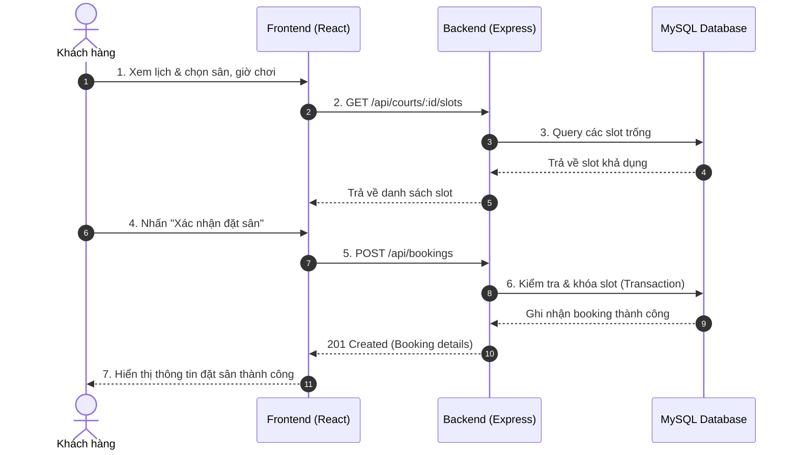
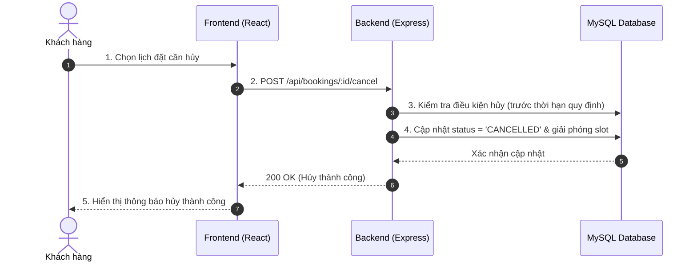

# Diagrams (Sơ đồ Kiến trúc & Thiết kế Hệ thống)

## 1. Kiến trúc Hệ thống (System Architecture)

```
[ Client: React + Vite ] 
         │ (HTTP/JSON)
         ▼
[ Server: Node.js + Express ]
         │ (mysql2 / connection pool)
         ▼
[ Database: MySQL ]
```

## 2. Luồng đặt sân (Booking Flow)



## 3. Luồng hủy đặt sân (Cancel Flow)


