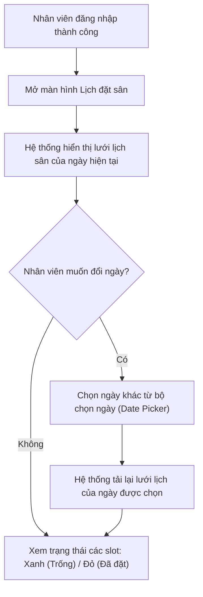
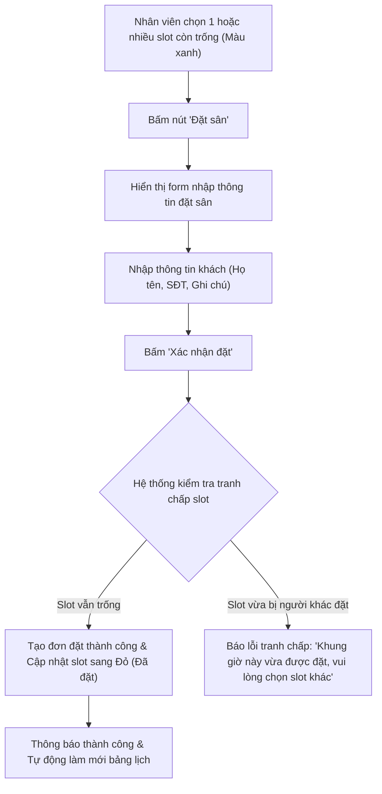
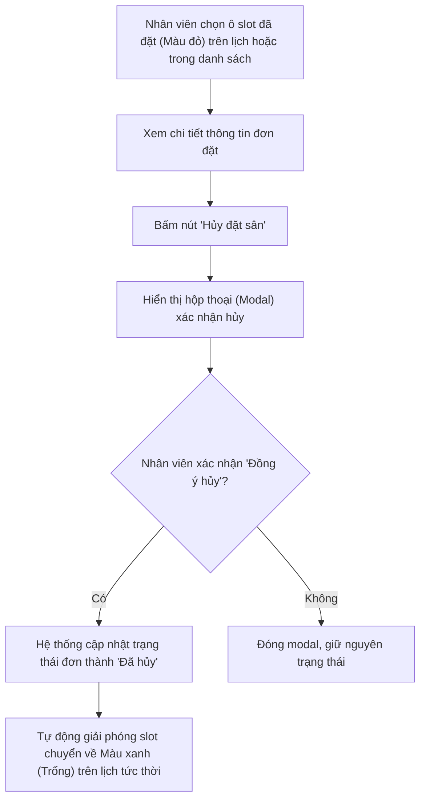

# TÀI LIỆU YÊU CẦU NGƯỜI DÙNG (URD)
## HỆ THỐNG ĐẶT SÂN CẦU LÔNG (BADMINTON COURT BOOKING SYSTEM)
### Phiên bản: v2.0 (Cập nhật ngày 21/10/2026)
> [!NOTE]
> **LỊCH SỬ THAY ĐỔI PHẠM VI DỰ ÁN**:  
> Phiên bản v2.0 này **thay thế hoàn toàn bản URD v1.0 cũ** (vốn có 3 vai trò Customer, Staff, Admin và 12 User Stories).  
> Theo quyết định điều chỉnh phạm vi ngày 21/10/2026, hệ thống được tinh gọn tập trung duy nhất vào nghiệp vụ tác nghiệp của **NHÂN VIÊN (Staff)** với **NĂM (05) chức năng cốt lõi**. Các vai trò Khách hàng, Quản trị viên và các phân hệ thanh toán, doanh thu, quản trị sân bãi đã được loại bỏ khỏi phạm vi dự án.

---

## 1. Giới thiệu và Bối cảnh

### 1.1. Bối cảnh bài toán
Tại các cụm sân cầu lông vừa và nhỏ, việc tiếp nhận yêu cầu đặt sân qua điện thoại hoặc khách đến trực tiếp tại quầy thường xuyên gặp phải tình trạng:
- Nhân viên ghi chép sổ tay hoặc file Excel thủ công, dễ dẫn đến nhầm lẫn, trùng lịch (Double Booking).
- Khi có nhiều nhân viên trực luân phiên giữa các ca, thông tin hủy sân hoặc dời giờ không được cập nhật tức thời khiến sân bị bỏ trống lãng phí hoặc hai khách cùng đến tranh chấp một sân.
- Nhân viên cần một công cụ trực quan trên nền tảng web (hỗ trợ cả máy tính tại quầy và điện thoại di động) để tra cứu nhanh tình trạng sân theo thời gian thực, thực hiện đặt sân cho khách và hủy lịch đặt một cách chính xác, minh bạch.

### 1.2. Mục tiêu hệ thống
Xây dựng ứng dụng web dành riêng cho Nhân viên sân cầu lông với mục tiêu:
1. Số hóa việc quản lý lịch sân, loại bỏ hoàn toàn tình trạng đặt trùng lịch (0% Double Booking).
2. Cho phép nhân viên tra cứu nhanh tình trạng sân trống theo ngày và khung giờ trực quan theo thời gian thực.
3. Hỗ trợ thao tác tạo đơn đặt sân và hủy đặt sân nhanh gọn, cập nhật ngay lập tức trạng thái trên lịch trực quan.
4. Đảm bảo giao diện thích ứng mượt mà (Responsive) trên cả điện thoại di động (khi nhân viên đi lại kiểm tra sân) và máy tính để bàn (tại quầy lễ tân).

---

## 2. Phạm vi người dùng và Vai trò nghiệp vụ

* **MỘT (01) VAI TRÒ NGHIỆP VỤ DUY NHẤT: NHÂN VIÊN (Staff)**.
  - Là người trực tiếp vận hành tại sân cầu lông, thực hiện tiếp nhận thông tin khách, tra cứu lịch, tạo đơn đặt sân và xử lý hủy đặt sân.
* **Lưu ý về trạng thái truy cập**:
  - Đối tượng "Người chưa đăng nhập" vào website chỉ là **trạng thái truy cập trước khi xác thực**, tuyệt đối không phải là một vai trò nghiệp vụ mới. Người chưa đăng nhập chỉ nhìn thấy màn hình Đăng nhập / Đăng ký và không thể xem lịch hay thao tác dữ liệu sân bãi.
* **Phạm vi LOẠI BỎ**:
  - Không có vai trò Khách hàng (Customer) tự đặt sân online.
  - Không có vai trò Quản trị viên (Admin).
  - Không có chức năng thanh toán trực tuyến, báo cáo doanh thu, cấu hình giá tiền hay điểm danh Check-in/Check-out.

---

## 3. Danh mục User Stories (Nhu cầu người dùng)

| Mã US | Tên User Story | Mô tả nhu cầu (Dạng As a / I want / So that) | Mức ưu tiên | Chức năng SRS tương ứng |
| :---: | :--- | :--- | :---: | :---: |
| **`US-01`** | **Đăng ký tài khoản nhân viên** | **Là một** nhân viên mới của sân cầu lông, **Tôi muốn** đăng ký tài khoản nhân viên trên hệ thống bằng thông tin cá nhân và mật khẩu, **Để** tôi có định danh làm việc và được cấp quyền truy cập vào các chức năng vận hành sân. | **Bắt buộc (Must-have)** | `FR-01` |
| **`US-02`** | **Đăng nhập hệ thống** | **Là một** nhân viên đã có tài khoản, **Tôi muốn** đăng nhập vào hệ thống bằng thông tin định danh và mật khẩu, **Để** xác thực phiên làm việc và bảo mật dữ liệu đặt sân của cơ sở. | **Bắt buộc (Must-have)** | `FR-02` |
| **`US-03`** | **Xem lịch đặt sân** | **Là một** nhân viên trực quầy, **Tôi muốn** xem bảng lịch trực quan thể hiện tình trạng tất cả các sân theo ngày và từng khung giờ (Trống / Đã đặt), **Để** tôi nắm bắt tình hình sân bãi tức thời và trả lời khách hàng nhanh chóng. | **Bắt buộc (Must-have)** | `FR-03` |
| **`US-04`** | **Đặt sân cho khách** | **Là một** nhân viên tiếp nhận yêu cầu đặt sân, **Tôi muốn** tạo đơn đặt sân trên một hoặc nhiều slot còn trống cho khách, **Để** giữ sân chắc chắn cho khách và hệ thống tự động khóa slot đó để ngăn người khác đặt trùng. | **Bắt buộc (Must-have)** | `FR-04` |
| **`US-05`** | **Hủy đặt sân** | **Là một** nhân viên tiếp nhận yêu cầu hủy, **Tôi muốn** thực hiện hủy một lượt đặt sân đã có trên hệ thống, **Để** giải phóng ngay khung giờ đó thành slot trống trên lịch cho khách khác có thể đặt. | **Bắt buộc (Must-have)** | `FR-05` |

---

## 4. Đặc tả các Luồng người dùng chính (Core User Flows)

### 4.1. Luồng 1: Xem lịch đặt sân (Timeline & Availability)

- **Mô tả hành động**: Nhân viên truy cập trang Lịch, chọn ngày cần tra cứu. Hệ thống hiển thị bảng ma trận: các hàng là danh sách các sân (Sân 1, Sân 2...), các cột là các khung giờ trong ngày (ví dụ: 06:00 - 07:00, ..., 21:00 - 22:00). Nhân viên nhận biết ngay khung giờ nào còn trống để tư vấn cho khách.

### 4.2. Luồng 2: Đặt sân cho khách (Booking Creation)

- **Mô tả hành động**: Nhân viên bấm vào ô slot trống trên lịch, nhập thông tin khách hàng và bấm xác nhận. Hệ thống lưu đơn đặt vào cơ sở dữ liệu, ngay lập tức đổi màu ô slot đó thành "Đã đặt" mà không cần tải lại toàn bộ trang web.

### 4.3. Luồng 3: Hủy đặt sân (Booking Cancellation)

- **Mô tả hành động**: Khi khách gọi điện hoặc đến báo hủy, nhân viên mở đơn đặt đó lên, bấm Hủy. Hộp thoại xác nhận hiển thị nhằm tránh bấm nhầm. Sau khi xác nhận, slot lập tức chuyển lại trạng thái Còn trống (Màu xanh) để sẵn sàng phục vụ khách khác.

---

## 5. Tiêu chí nghiệm thu người dùng (Acceptance Criteria)

1. **Về Đăng ký & Đăng nhập**:
   - Nhân viên đăng ký thành công khi cung cấp đầy đủ thông tin hợp lệ (SĐT đúng định dạng, mật khẩu đủ độ dài).
   - Đăng nhập đúng cấp quyền vào phiên làm việc; đăng nhập sai thông tin hiển thị thông báo lỗi rõ ràng, không tiết lộ tài khoản có tồn tại hay không.
   - Phiên làm việc được duy trì qua Token; khi hết hạn hoặc đăng xuất thì chuyển hướng an toàn về trang đăng nhập.
2. **Về Xem lịch**:
   - Lưới lịch hiển thị rõ ràng từng sân và từng khung giờ.
   - Phân biệt trực quan trạng thái: Màu xanh (Còn trống) và Màu đỏ (Đã đặt).
   - Hỗ trợ đổi ngày tra cứu nhanh chóng, dữ liệu tải mượt mà.
3. **Về Đặt sân**:
   - Chỉ cho phép chọn và đặt các slot đang ở trạng thái Trống (Màu xanh).
   - Ngăn chặn triệt để việc đặt trùng lịch (Double Booking): Nếu hai nhân viên cùng thao tác trên 1 slot, chỉ 1 người thành công, người còn lại nhận thông báo lỗi tranh chấp rõ ràng.
   - Slot sau khi đặt thành công phải đổi màu tức thời sang trạng thái Đã đặt (Màu đỏ).
4. **Về Hủy đặt sân**:
   - Luôn hiển thị hộp thoại xác nhận trước khi thực hiện hành động hủy để tránh mất dữ liệu do sơ suất.
   - Sau khi hủy thành công, ô lịch tương ứng phải chuyển ngay về trạng thái Trống (Màu xanh).
5. **Về Tính thích ứng (Responsive)**:
   - Toàn bộ giao diện 5 chức năng hoạt động hoàn hảo trên cả màn hình di động (chiều rộng hẹp từ 320px) và máy tính để bàn (1366px trở lên).
   - Form nhập liệu, nút bấm không bị tràn viền, không phát sinh cuộn ngang toàn trang. Bảng lịch có thể cuộn ngang trong vùng chứa riêng nhưng vẫn giữ cố định tên sân để nhân viên nhận biết.

---

## 6. Danh mục Câu hỏi Nghiệp vụ còn thiếu (Cần người dùng / GV xác nhận)

Các quy tắc dưới đây hiện **chưa có văn bản quy định chính thức** và đang được tạm định hình dưới dạng `[Đề xuất kỹ thuật chờ xác nhận]`. Cần sự xác nhận từ phía người dùng/chủ sân để chuẩn hóa:

| STT | Vấn đề nghiệp vụ | Tình trạng hiện tại | Đề xuất kỹ thuật tạm thời | Tác động nếu thay đổi |
| :---: | :--- | :---: | :--- | :--- |
| **Q1** | **Chính sách đăng ký tài khoản nhân viên** | `Chưa xác định` | Cho phép đăng ký tự do với SĐT và Mật khẩu, kích hoạt dùng được ngay để phục vụ làm đồ án và test. | Nếu cần duyệt bởi Quản lý/Mã mời nội bộ thì phải bổ sung trường nhập mã hoặc trạng thái chờ duyệt. |
| **Q2** | **Khung giờ mở cửa & Thời lượng một slot** | `Đề xuất chờ xác nhận` | Cụm sân hoạt động từ **06:00 đến 22:00**, chia thành các block tròn giờ cố định **60 phút** (06:00-07:00, ..., 21:00-22:00). | Nếu cho phép đặt khung giờ lẻ (30p, 90p) thì cấu trúc cơ sở dữ liệu và lưới lịch hiển thị sẽ phức tạp hơn. |
| **Q3** | **Dữ liệu bắt buộc khi tạo đơn đặt sân** | `Đề xuất chờ xác nhận` | Bắt buộc: **Họ tên khách hàng**, **Số điện thoại liên hệ**, Ngày, Sân và Khung giờ. Trường Ghi chú là tùy chọn. | Nếu chỉ cần chọn sân/giờ mà không cần SĐT khách thì giảm ràng buộc validation form. |
| **Q4** | **Phân quyền và Phạm vi hủy đặt sân** | `Đề xuất chờ xác nhận` | Nhân viên được quyền hủy **bất kỳ lịch đặt nào** trên hệ thống khi có yêu cầu (hệ thống tự động lưu vết ID nhân viên thực hiện hủy). | Nếu chỉ cho phép nhân viên hủy lịch do chính tài khoản của mình tạo thì cần bổ sung kiểm tra quyền sở hữu đơn đặt. |
| **Q5** | **Thời hạn và Điều kiện hủy sân** | `Chưa xác định` | Cho phép nhân viên hủy tại bất kỳ thời điểm nào trước hoặc trong ngày chơi để xử lý linh hoạt tại quầy. | Nếu có quy chế phạt hoặc chặn hủy sát giờ (ví dụ: cấm hủy trước < 2 giờ) thì cần bổ sung logic kiểm tra thời gian. |
